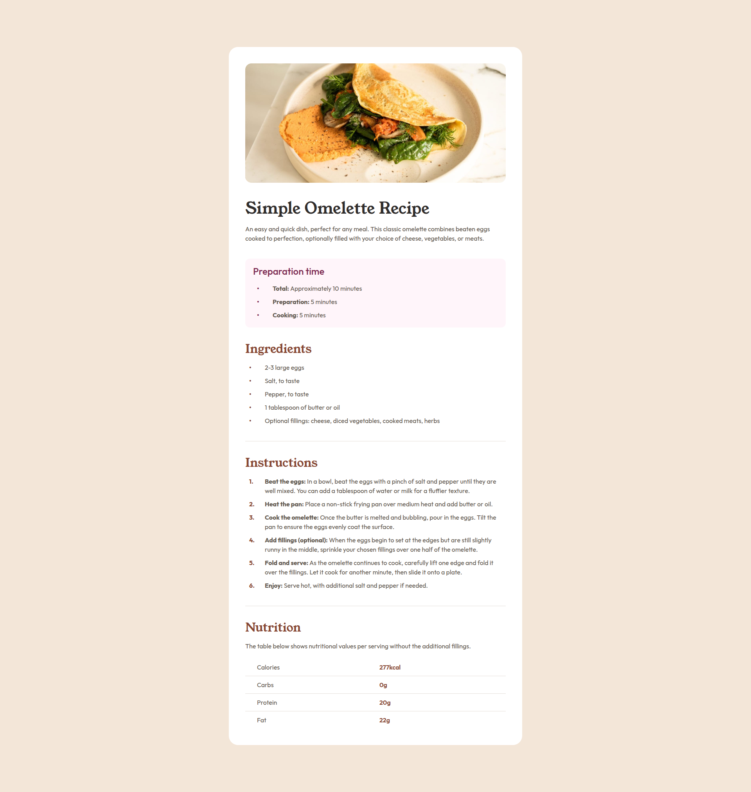
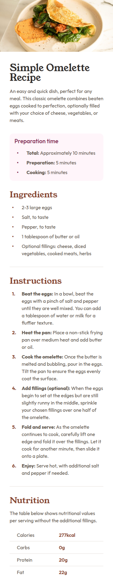

# Frontend Mentor - Recipe page solution

This is a solution to the [Recipe page challenge on Frontend Mentor](https://www.frontendmentor.io/challenges/recipe-page-KiTsR8QQKm).

## Table of contents

- [Overview](#overview)
  - [The challenge](#the-challenge)
  - [Screenshot](#screenshot)
  - [Links](#links)
- [My process](#my-process)
  - [Built with](#built-with)
  - [What I learned](#what-i-learned)
  - [Continued development](#continued-development)
  - [Useful resources](#useful-resources)
  - [AI Collaboration](#ai-collaboration)
- [Author](#author)

## Overview

### Screenshot

| Desktop | Mobile |
| :-----: | :-----:|
|  | 

### Links

- Solution URL: [Add solution URL here](https://your-solution-url.com)
- Live Site URL: [Add live site URL here](https://your-live-site-url.com)

## My process

### Built with

- Semantic HTML5 markup
- CSS custom properties
- Flexbox

### What I learned

- Table layout and styling.
- To set ```max-width``` in pixel instead of ```rem```, as ```rem``` scale when used inside ```@media``` queries.
- Creating custom bullet points using pseudo-elements.

### Continued development

- Focus more on mobile first development and plan ahead for it.

### Useful resources

- [HTML Table basics](https://developer.mozilla.org/en-US/docs/Learn_web_development/Core/Structuring_content/HTML_table_basics)
- [Styling tables](https://developer.mozilla.org/en-US/docs/Learn_web_development/Core/Styling_basics/Tables) 
- [Psuedo-classes and Pseudo-elements](https://developer.mozilla.org/en-US/docs/Learn_web_development/Core/Styling_basics/Pseudo_classes_and_elements)

### AI Collaboration

- Used Chatgpt to find out how to create custom numbered bullets.

## Author

- Frontend Mentor - [@shubhamadak535](https://www.frontendmentor.io/profile/shubhamadak535)

